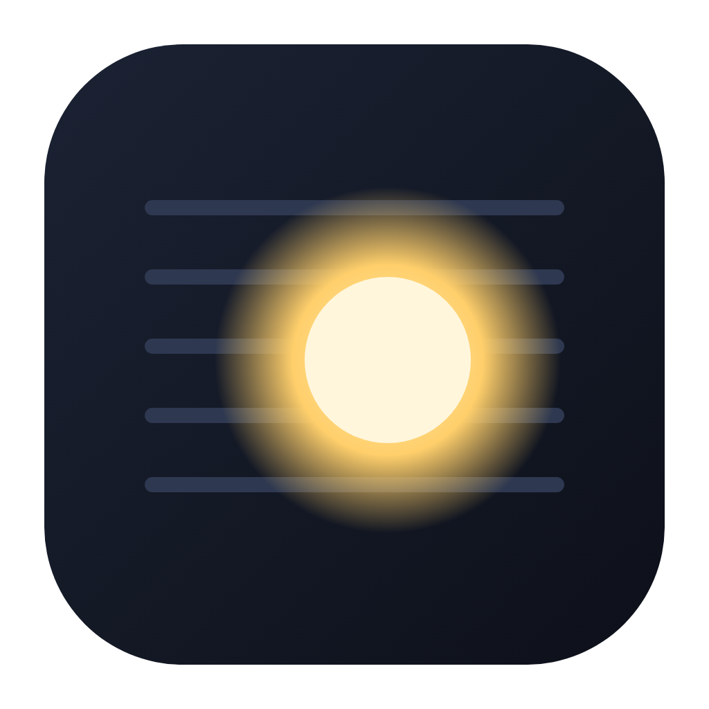
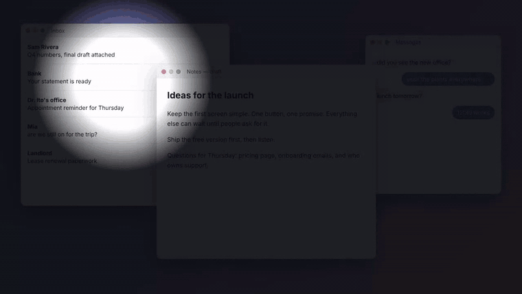
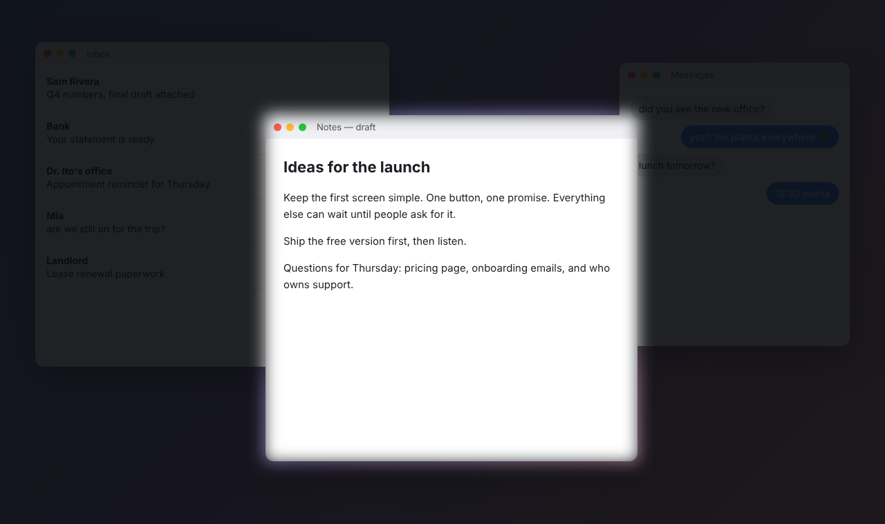
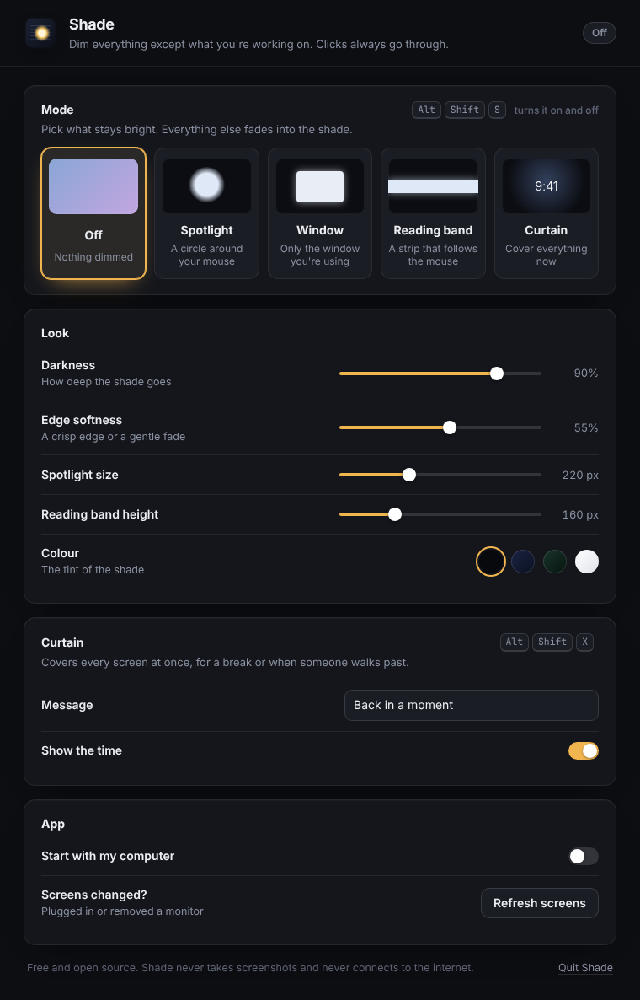

<div align="center">



# Shade

**A privacy screen for your desktop.**
Dim everything except what you're working on, so the person next to you on the train sees nothing but a dark screen.
Free and open source. No account, no ads, no paywall.

Windows · macOS · Linux



[Demo video (MP4)](docs/demo.mp4) · [Install](#install) · [Modes](#modes) · [Compared to paid privacy apps](#compared-to-paid-privacy-screen-apps)

</div>

---

## Install

**Windows** (PowerShell, installs for your user only, no admin needed):

```powershell
irm https://raw.githubusercontent.com/llamaboi55/shade/main/scripts/install.ps1 | iex
```

**macOS and Linux:**

```sh
curl -fsSL https://raw.githubusercontent.com/llamaboi55/shade/main/scripts/install.sh | sh
```

Both commands download the latest release straight from GitHub and install it. Files fetched this way don't get flagged, so there's no "unknown publisher" warning to click through. Run the same command again to update. You can also download the installer for your system from [Releases](https://github.com/llamaboi55/shade/releases/latest).

**Build it yourself** (needs [Rust](https://rustup.rs) and Node.js 18+; on Linux also the [Tauri packages](https://tauri.app/start/prerequisites/)):

```sh
git clone https://github.com/llamaboi55/shade && cd shade && npm install && npm run build
```

**Just look at it** (no install): `npm run preview`, then open the printed address.

## Modes

| | |
|---|---|
| **Spotlight** | A soft circle of light follows your mouse. Everything else is dark. |
| **Window** | Only the window you're using stays visible, and the shade follows you as you switch windows. Every other window and every other screen goes dark. |
| **Reading band** | A horizontal strip follows the mouse, for reading line by line, or for keeping just one row of a spreadsheet visible. |
| **Curtain** | Covers every screen instantly with a calm cover showing the time and a message. Double-click it or press **Alt Shift X** to come back to exactly where you were. |



- **Alt Shift S** turns the shade on and off (it remembers your last mode). Clicking the tray icon does the same.
- **Alt Shift X** drops or lifts the curtain from anywhere.
- In every mode except the curtain, all clicks and typing go straight through to your apps. The shade is only something you look through.
- In settings you can change darkness, edge softness, spotlight size, band height, color (black, midnight, forest or frost) and the curtain message. You can also make Shade start with your computer.
- It covers every connected screen. If you plug in or remove a monitor, press **Refresh** in settings.



## Compared to paid privacy screen apps

| | Shade | Typical paid privacy screen app |
|---|---|---|
| Price | Free | $5 to $13, or a subscription |
| Windows and Linux | ✅ | ❌ Mac only |
| Spotlight around the mouse | ✅ | ✅ |
| Only the focused window | ✅ | Some |
| Reading band | ✅ | Rare |
| Instant curtain with a hotkey | ✅ | Some |
| Works on every monitor | ✅ | Varies |
| Open source | ✅ | ❌ |

## Privacy

Shade never takes screenshots, never records anything and never connects to the internet. To know which window to keep visible, it asks the system for the position of the focused window, and nothing else. Settings stay on your computer.

## Good to know

- A software shade dims the screen, it doesn't encrypt it. Someone looking over your shoulder sees darkness, but anything on screen can still be captured by screen-sharing or recording apps. Turn Shade on while you're sharing if you want it in the stream too.
- **macOS:** Window mode reads window positions through the system's public window list, which needs no permission. If macOS ever asks for Screen Recording permission, you can say no: Shade doesn't use it, and the spotlight and band modes keep working anyway.
- **Linux:** transparent overlays need a compositor (GNOME, KDE, Cinnamon and most modern desktops have one). Window mode works on X11. On Wayland, apps can't see other windows' positions, so use spotlight or band mode there.

## Development

```sh
npm install
npm run preview      # browser preview with a pretend desktop, no Rust build needed
npm run dev          # the real app with hot reload
npm test             # geometry tests (node --test) and Rust tests
```

- `src/js/overlay.js`: the shade itself, with the drawing loop, cutouts and curtain
- `src/js/shapes.js`: the geometry (tested)
- `src/js/settings.js`: the settings window
- `src-tauri/src/lib.rs`: one overlay per monitor, mouse and focused-window tracking, tray and shortcuts

Releases are built for all three systems by GitHub Actions whenever the version in `src-tauri/tauri.conf.json` changes on `main`.

## Where the idea came from

Found through this Instagram Reel: https://www.instagram.com/p/DedroLaFxgY/
This project isn't affiliated with the app shown there.

## License

MIT. Shade is an independent project and isn't affiliated with any other privacy screen app.
